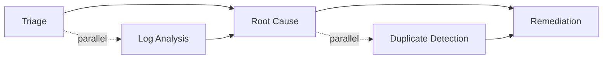

# Agent and RAG Documentation

## DefectMind AI — AI Agents and Retrieval Pipeline

---

## Agent Overview

The system uses five specialised AI agents orchestrated in a parallel-then-sequential pipeline:



**Execution model:**
- **Wave 1 (parallel):** Triage Agent + Log Analysis Agent run concurrently via `asyncio.gather`
- **Wave 2 (parallel):** Root Cause Agent + Duplicate Detection Agent run concurrently (Root Cause needs Wave 1 results; Duplicate Detection runs independently)
- **Wave 3 (sequential):** Remediation Agent runs after all four prior agents complete

All agents are wrapped in safe-call handlers. A single agent failure returns a structured error result without crashing the pipeline.

---

## 1. Triage Agent

**File:** `backend/agents/triage_agent.py`
**Version:** `2.0.0-M2`
**Introduced:** Milestone 2

### Purpose

Classify the bug's severity, priority, category, and affected component.

### Input

The agent receives the full `bug_data` dictionary:

| Field | Description |
|---|---|
| `title` | Bug title string |
| `description` | Free-text description |
| `stack_trace` | Optional stack trace text |
| `error_logs` | Optional error log text |
| `environment` | Optional environment description |

### Output

```json
{
  "agent": "Triage Agent",
  "version": "2.0.0-M2",
  "status": "success",
  "duration": 0.001,
  "timestamp": "2025-10-14T09:30:00.000000",
  "result": {
    "severity": "high",
    "priority": "P1",
    "category": "Null Reference",
    "component": "Authentication",
    "confidence": 0.85,
    "reasoning": "Classified as high severity Null Reference defect affecting the Authentication component. Stack trace analysis supports this classification."
  }
}
```

| Output Field | Type | Allowed Values |
|---|---|---|
| `severity` | enum | `critical \| high \| medium \| low` |
| `priority` | enum | `P0 \| P1 \| P2 \| P3` |
| `category` | string | See categories below |
| `component` | string | See components below |
| `confidence` | float | 0.0 – 1.0 |
| `reasoning` | string | Human-readable explanation |

**Severity → Priority mapping:**
| Severity | Priority |
|---|---|
| critical | P0 |
| high | P1 |
| medium | P2 |
| low | P3 |

### Method

**Step 1 — Keyword scoring:** All text fields are concatenated to lowercase and matched against `SEVERITY_KEYWORDS`:

| Severity | Example keywords |
|---|---|
| critical | `crash`, `fatal`, `data loss`, `security`, `oom`, `buffer overflow`, `rce` |
| high | `error`, `fail`, `exception`, `null`, `timeout`, `deadlock`, `race condition` |
| medium | `slow`, `incorrect`, `wrong`, `unexpected`, `warning` |
| low | `enhancement`, `documentation`, `cleanup`, `refactor` |

**Step 2 — Category detection:** Matched against 10 `CATEGORY_PATTERNS`:
`Null Reference`, `Memory Management`, `Concurrency`, `Network/IO`, `Security`, `Input Validation`, `UI/Rendering`, `Performance`, `Logic Error`, `Configuration`

**Step 3 — Component detection:** Matched against 14 `COMPONENT_PATTERNS`:
`Networking`, `Database`, `Authentication`, `UI/Frontend`, `API`, `File System`, `Memory Management`, `Concurrency`, `Security`, `Performance`, `Logging`, `Configuration`, `Testing`, `Build/Deploy`

**Step 4 — Confidence scoring:** Base 0.50, incremented by available data fields (title +0.10, description >50 chars +0.10, stack_trace +0.15, error_logs +0.10, environment +0.05) and keyword match density.

**Step 5 — Optional LLM refinement:** When a real (non-mock) LLM is available, a structured prompt is sent to refine the deterministic classification. Falls back to deterministic result on LLM failure.

**Fallback:** On any exception, returns `medium / P2 / Logic Error / Unknown / 0.3` confidence.

---

## 2. Log Analysis Agent

**File:** `backend/agents/log_analysis_agent.py`
**Version:** `2.0.0-M2`
**Introduced:** Milestone 2

### Purpose

Parse and analyse error logs, stack traces, and exception patterns to extract structured exception information.

### Input

| Field | Description |
|---|---|
| `stack_trace` | Stack trace text (Java/Python/Node.js) |
| `error_logs` | Error log lines |
| `description` | Bug description (for pattern extraction) |

### Output

```json
{
  "agent": "Log Analysis Agent",
  "version": "2.0.0-M2",
  "status": "success",
  "duration": 0.002,
  "timestamp": "2025-10-14T09:30:00.000000",
  "result": {
    "exceptions": [
      {
        "exception_type": "java.lang.NullPointerException",
        "error_message": "Cannot invoke User.getProfileData() because user is null",
        "file_name": "UserProfileService.java",
        "class_name": "UserProfileService",
        "method_name": "loadProfile",
        "line_number": 142,
        "code_path": "UserProfileService.loadProfile",
        "confidence": 0.9
      }
    ],
    "error_patterns": ["Null reference/pointer"],
    "failure_point": "UserProfileService.java line 142 in loadProfile (UserProfileService)",
    "code_path": "UserProfileService.loadProfile",
    "stack_trace_summary": "Stack trace detected (java format). Contains 4 lines. 1 stack frames",
    "suspicious_logs": ["[ERROR] UserProfileService - Null user reference"],
    "confidence": 0.75,
    "summary": "Found 1 exception(s): java.lang.NullPointerException..."
  }
}
```

### ExceptionInfo Fields

| Field | Type | Description |
|---|---|---|
| `exception_type` | string | Full exception class name |
| `error_message` | string | Exception message text |
| `file_name` | string \| null | Source file |
| `class_name` | string \| null | Class where exception occurred |
| `method_name` | string \| null | Method where exception occurred |
| `line_number` | integer \| null | Line number |
| `code_path` | string \| null | Dotted path to failure location |
| `confidence` | float | 0.0–1.0 parser confidence |

### Method

**Language Detection:** The `StackTraceParser.detect_language()` method identifies the stack trace language:

| Language | Indicators |
|---|---|
| Java | `java.lang.`, `.java:`, `at com.`, `Caused by:` |
| Python | `Traceback (most recent call last)`, `File "`, `.py:`, `TypeError:` |
| Node.js | `node:`, `.js:`, `at Object.`, `npm ERR!` |

**Language-specific parsers:**

- **Java:** Regex pattern `(ExceptionType): (message)` + `at Class.method(File.java:line)`. Handles `Caused by:` chains. Confidence 0.9 when file+line found, 0.6 otherwise.
- **Python:** Regex for `File "path", line N, in func` + `ErrorType: message`. Uses last file reference as failure point. Confidence 0.85 with file, 0.5 without.
- **Node.js:** Regex for `ErrorType: message` + `at Function (file.js:line:col)`. Confidence 0.8 with file, 0.5 without.
- **Generic:** Extracts `ERROR|FATAL|CRITICAL` log lines. Confidence 0.4.

**Error patterns detected (10 categories):**
`Null reference/pointer`, `Resource leak`, `Concurrency issue`, `Timeout`, `Connection failure`, `Permission denied`, `Out of memory`, `Stack overflow`, `Type mismatch`, `Index out of bounds`

**Suspicious log extraction:** Lines containing `error`, `fatal`, `critical`, `exception`, `fail`, `warn` keywords — up to 10 entries.

---

## 3. Root Cause Agent

**File:** `backend/agents/root_cause_agent.py`
**Version:** `3.0.0-M3`
**Introduced:** Milestone 3

### Purpose

Identify the most probable root cause using triage and log analysis context augmented by RAG retrieval of similar historical defects. Separates retrieved evidence from agent inference.

### Input

| Source | Content |
|---|---|
| `bug_data` | Original bug report (title, description, stack_trace) |
| `triage_result` | Triage Agent output wrapper dict |
| `log_result` | Log Analysis Agent output wrapper dict |
| ChromaDB | Top-5 most similar historical defects |

### Output

```json
{
  "agent": "Root Cause Agent",
  "version": "3.0.0-M3",
  "status": "success",
  "duration": 0.05,
  "timestamp": "...",
  "result": {
    "status": "success",
    "probable_cause": "A null or uninitialized object is being accessed without a prior null check in the Authentication component. The immediate trigger is a java.lang.NullPointerException.",
    "hypotheses": [
      {
        "hypothesis": "A null reference is accessed in the processing pipeline without a prior null-check.",
        "confidence": 0.78,
        "supporting_evidence": ["Exception type confirms null access", "Similar historical defect MOZ-1001 had same root cause"],
        "causal_chain": "Uninitialised input → processing loop → null access → exception"
      }
    ],
    "confidence": 0.5,
    "reasoning": "Category 'Null Reference' in component 'Authentication' detected via triage.",
    "related_components": ["Authentication"],
    "retrieved_evidence": [
      {
        "bug_id": "MOZ-1001",
        "document": "NullPointerException in NetworkManager when connection drops...",
        "component": "Networking",
        "severity": "critical",
        "resolution": "Fixed by adding null check before accessing connection object.",
        "similarity_score": 0.89,
        "source": "historical_defect_database"
      }
    ],
    "agent_reasoning": "Based on Null Reference pattern in the Authentication component with a java.lang.NullPointerException exception.",
    "evidence_summary": "Retrieved 5 similar historical defect(s). Closest match: MOZ-1001 (89.0% similarity).",
    "insufficient_evidence_reason": null
  }
}
```

### Output Fields

| Field | Description |
|---|---|
| `status` | `"success"`, `"insufficient_evidence"`, or `"error"` |
| `probable_cause` | Primary root cause statement |
| `hypotheses` | Up to 3 ranked hypotheses with evidence and causal chains |
| `confidence` | Overall confidence 0.0–1.0 |
| `reasoning` | Step-by-step causal reasoning |
| `related_components` | Components implicated in the root cause |
| `retrieved_evidence` | **Evidence from the historical KB** — clearly labelled |
| `agent_reasoning` | **What the agent inferred** — clearly labelled as not from evidence |
| `evidence_summary` | One-sentence KB retrieval summary |
| `insufficient_evidence_reason` | Populated when `status = "insufficient_evidence"` |

### Method

1. **Signal extraction:** Combines triage category/component/severity, log exceptions/failure_point/error_patterns, and bug description into a signals dict.

2. **Minimum signals check:** If `signal_count < 1`, returns `"insufficient_evidence"`.

3. **RAG retrieval:** Builds query from `title + description + exception_type + error_message + category + component`, embeds, searches ChromaDB for top-5.

4. **LLM reasoning:** Sends structured prompt with current bug signals and labelled retrieved evidence. Falls back to deterministic analysis when LLM unavailable.

5. **Deterministic analysis (fallback):** Maps category to cause templates:

| Category | Template |
|---|---|
| Null Reference | "A null or uninitialized object is being accessed without a prior null check in the `{component}` component." |
| Memory Management | "A resource in `{component}` is not being released properly, leading to memory pressure or a resource leak." |
| Concurrency | "A race condition or inadequate synchronization in `{component}` allows concurrent threads to corrupt shared state." |
| Network/IO | "An I/O operation in `{component}` lacks proper timeout handling or retry logic." |
| Security | "Input in `{component}` is not properly validated or sanitized." |
| Performance | "An inefficient algorithm or missing cache in `{component}` causes excessive resource consumption." |

6. **Confidence computation:** `base + evidence_boost` where `evidence_boost = min(0.15, len(evidence) × 0.04)`.

7. **Sparse report cap:** When `bug_data` has no `stack_trace`, no `error_logs`, and a description < 80 chars, final confidence is capped at 0.50 to prevent mock evidence from producing overconfident results on vague reports.

8. **Insufficient evidence threshold:** `confidence < 0.25` → returns `"insufficient_evidence"`.

### Evidence vs. Reasoning Separation

A core design principle: the output explicitly separates:
- `retrieved_evidence` — data retrieved from ChromaDB (bug ID, document text, similarity score, metadata)
- `agent_reasoning` — what was inferred by the agent beyond the retrieved data

The LLM prompt enforces this with:
```
=== RETRIEVED HISTORICAL EVIDENCE (from defect database) ===
[Evidence 1] Bug ID: MOZ-1001 | Similarity: 89.00%
  Description: NullPointerException in NetworkManager...
  Component: Networking
  Resolution: Fixed by adding null check...
```

---

## 4. Duplicate Detection Agent

**File:** `backend/agents/duplicate_detection_agent.py`
**Version:** `3.0.0-M3`
**Introduced:** Milestone 3

### Purpose

Detect potential duplicate bugs by comparing the current bug against all entries in the ChromaDB knowledge base using semantic similarity.

### Input

| Field | Description |
|---|---|
| `title` | Bug title |
| `description` | Bug description |
| `stack_trace` | First 300 chars used in query |

*Note: This agent is independent — it does not use Triage or Log Analysis results.*

### Output

```json
{
  "agent": "Duplicate Detection Agent",
  "version": "3.0.0-M3",
  "status": "success",
  "duration": 0.03,
  "timestamp": "...",
  "result": {
    "classification": "related_issue",
    "top_match_similarity": 0.89,
    "duplicate_probability": 0.6195,
    "matched_bugs": [
      {
        "bug_id": "MOZ-1001",
        "title": "NullPointerException in NetworkManager when connection drops...",
        "similarity_score": 0.89,
        "classification": "likely_duplicate",
        "component": "Networking",
        "severity": "critical",
        "exception_type": "",
        "resolution_summary": "Fixed by adding null check before accessing connection object."
      }
    ],
    "analysis_summary": "Related Issue — 5 candidate(s) found. Highest similarity: 89.0%. Closest match: MOZ-1001 (89.0%).",
    "thresholds_used": {
      "likely_duplicate": 0.82,
      "related_issue": 0.55
    },
    "is_duplicate": false,
    "similarity_score": 0.89
  }
}
```

### Classification Thresholds

| Threshold | Value | Meaning |
|---|---|---|
| `LIKELY_DUPLICATE_THRESHOLD` | **0.82** | similarity ≥ 0.82 → `likely_duplicate` |
| `RELATED_ISSUE_THRESHOLD` | **0.55** | similarity ≥ 0.55 → `related_issue` |
| Below both | — | `new_unmatched` |
| No embedding available | — | `insufficient_evidence` |

### Duplicate Probability

Weighted score using top-3 matches:
```
probability = 0.60 × score[0] + 0.25 × score[1] + 0.15 × score[2]
```
Only scores above `RELATED_ISSUE_THRESHOLD` contribute.

### Method

1. Build query: `title + description + stack_trace[:300]`
2. Embed with `EmbeddingService.embed_text()`
3. Search ChromaDB for top-5 results
4. Classify each match against thresholds
5. Overall classification = the highest classification among all matches
6. Return `insufficient_evidence` if embedding/search unavailable

### Legacy Compatibility

The result also includes legacy fields (`is_duplicate`, `similarity_score`, `matching_bugs`) for backward compatibility with older frontend code paths.

---

## 5. Remediation Agent

**File:** `backend/agents/remediation_agent.py`
**Version:** `3.0.0-M3`
**Introduced:** Milestone 3

### Purpose

Generate actionable fix recommendations grounded in historical resolutions from the knowledge base. Explicitly labels whether suggestions come from historical evidence, best practices, or agent reasoning.

### Input

| Source | Content |
|---|---|
| `bug_data` | Original bug report |
| `triage_result` | Triage Agent output |
| `log_result` | Log Analysis Agent output |
| `root_cause_result` | Root Cause Agent output |
| `duplicate_result` | Duplicate Detection Agent output |
| ChromaDB | Top-5 historical resolutions |

### Output

```json
{
  "agent": "Remediation Agent",
  "version": "3.0.0-M3",
  "status": "success",
  "duration": 0.04,
  "timestamp": "...",
  "result": {
    "status": "success",
    "suggested_fix": "Add a null/bounds check at the entry of the affected method. Use Optional or guard clauses to handle missing values.",
    "fix_source": "historical_evidence",
    "confidence": 0.93,
    "implementation_steps": [
      {
        "step": "Locate the failure point identified in the log analysis.",
        "detail": "Use the code path from the stack trace to navigate to the exact line.",
        "is_speculative": false
      },
      {
        "step": "Review adjacent code for the same pattern.",
        "detail": "Search for similar unchecked accesses in the same component.",
        "is_speculative": true
      }
    ],
    "debugging_steps": [
      "Reproduce the issue locally with the same inputs.",
      "Add a breakpoint at the identified failure point."
    ],
    "validation_steps": [
      "Write a unit test that reproduces the failure.",
      "Run the test suite for the affected component."
    ],
    "regression_tests": [
      "Run full test suite for the affected module.",
      "Execute integration tests for the user-facing workflow."
    ],
    "historical_resolutions": [],
    "best_practices": [
      "Always validate inputs at method boundaries.",
      "Use Optional types or null-object pattern for safer APIs."
    ],
    "estimated_effort": "2-4 hours",
    "risk_level": "medium",
    "evidence_summary": "",
    "agent_reasoning": "Fix derived from the identified root cause: unguarded null access."
  }
}
```

### Fix Source Labels

| `fix_source` | Condition |
|---|---|
| `"historical_evidence"` | Top retrieved resolution has similarity ≥ 0.70 |
| `"best_practice"` | LLM signals `fix_from_best_practice: true` |
| `"agent_reasoning"` | All other cases |

### ImplementationStep Fields

| Field | Type | Description |
|---|---|---|
| `step` | string | What to do |
| `detail` | string \| null | Optional code example or hint |
| `is_speculative` | boolean | **`true` = not confirmed by historical evidence** |

Speculative steps are tagged `"Inferred"` in the UI and never presented as confirmed fixes.

### Method

1. **Signal extraction:** Flattens all upstream agent results into a signals dict (severity, category, component, probable_cause, exception_type, error_message, failure_point).

2. **RAG retrieval:** Builds query from `title + probable_cause + category + component + exception_type`, searches ChromaDB for top-5 historical resolutions.

3. **LLM generation:** Sends structured prompt with signals and labelled historical resolutions. Falls back to deterministic remediation if LLM unavailable.

4. **Deterministic remediation (fallback):** Maps category to fix templates (7 categories: Null Reference, Memory Management, Concurrency, Network/IO, Security, Input Validation, Performance). Incorporates top historical resolution if similarity ≥ 0.60.

5. **Confidence computation:** `base_conf + min(0.15, len(resolutions) × 0.04)`, capped at 0.95.

6. **Risk level:** Returned from LLM; validated as `low|medium|high`, defaulting to `medium`.

---

## 6. Agent Orchestrator

**File:** `backend/agents/orchestrator.py`
**Version:** `3.0.0-M3`

### Class: `AgentOrchestrator`

```python
AgentOrchestrator(
    llm_service=LLMService(),
    chroma_service=ChromaService(),
    embedding_service=EmbeddingService()
)
```

### Pipeline: `run_m3_pipeline(bug_data)`

```python
async def run_m3_pipeline(bug_data: Dict) -> Dict:
    # Wave 1: parallel
    triage_result, log_result = await asyncio.gather(
        _safe_run(triage_agent, bug_data, "triage"),
        _safe_run(log_agent, bug_data, "log_analysis")
    )

    # Wave 2: parallel
    root_cause_result, duplicate_result = await asyncio.gather(
        _safe_run_with_context(rc_agent, bug_data, triage_result, log_result, "root_cause"),
        _safe_run(dup_agent, bug_data, "duplicate_detection")
    )

    # Wave 3: sequential
    remediation_result = await _safe_run_remediation(
        rem_agent, bug_data, triage_result, log_result, root_cause_result, duplicate_result
    )

    return {
        "bug_id": ...,
        "milestone": "M3",
        "status": "completed",
        "total_duration": ...,
        "triage": ...,
        "log_analysis": ...,
        "root_cause": ...,
        "duplicate_detection": ...,
        "remediation": ...,
        "agents": {...}  # raw agent wrapper dicts
    }
```

### Safe-Call Wrappers

All agents are called via safe-call helpers that catch exceptions and return a structured error result:

```python
async def _safe_run(agent, bug_data, agent_name) -> Optional[Dict]:
    try:
        return await agent.analyze(bug_data)
    except Exception as e:
        logger.error(f"Agent '{agent_name}' failed: {e}")
        return {"agent": agent_name, "status": "error", "result": {}, ...}
```

This ensures one failing agent never propagates an exception to the caller.

### Backward Compatibility

- `run_m2_pipeline()` — Triage + Log Analysis only (M2 callers)
- `run_full_pipeline()` — alias for `run_m3_pipeline()`

### Agent Lazy Initialisation

Root Cause, Duplicate Detection, and Remediation agents are lazy-initialised to avoid circular imports:

```python
def _get_root_cause_agent(self):
    if self._root_cause_agent is None:
        from agents.root_cause_agent import RootCauseAgent
        self._root_cause_agent = RootCauseAgent(self.llm, self.chroma, self.embeddings)
    return self._root_cause_agent
```

---

## 7. RAG Pipeline — Complete Flow

### 7.1 Embedding Model

**Model:** `sentence-transformers/all-MiniLM-L6-v2`
**Dimensions:** 384
**Library:** `sentence-transformers 2.2.2`

```python
class EmbeddingService:
    def embed_text(self, text: str) -> List[float]:
        # Real mode:
        embedding = self.model.encode(text, convert_to_numpy=True)
        return embedding.tolist()

        # Mock mode (no model installed):
        np.random.seed(hash(text) % (2**31))
        return np.random.randn(self.dimension).tolist()
```

The same model and service instance are used across all agents, the KB growth mechanism, and the analytics clustering.

### 7.2 ChromaDB Query

```python
class ChromaService:
    def search(self, query_embedding: List[float], top_k: int = 5) -> List[Dict]:
        results = self.collection.query(
            query_embeddings=[query_embedding],
            n_results=top_k
        )
        # Convert distances to similarity scores:
        for i in range(len(results['ids'][0])):
            score = 1 - results['distances'][0][i]  # cosine distance → similarity
            yield {
                'id': results['ids'][0][i],
                'document': results['documents'][0][i],
                'metadata': results['metadatas'][0][i],
                'score': score
            }
```

**Distance metric:** Cosine (configured when collection is created). Score = `1 - distance`.

### 7.3 Evidence Injection Into LLM Prompt

Both Root Cause and Remediation agents inject evidence with explicit labelling:

```
=== RETRIEVED HISTORICAL EVIDENCE (from defect database) ===
[Evidence 1] Bug ID: MOZ-1001 | Similarity: 89.00%
  Description: NullPointerException in NetworkManager when connection drops...
  Component:   Networking
  Severity:    critical
  Resolution:  Fixed by adding null check before accessing connection object.

=== INSTRUCTIONS ===
1. Clearly distinguish what you KNOW from the evidence above vs. what you are INFERRING.
2. Use the historical evidence only as supporting context, not as a direct answer.
3. If there is insufficient data to form a confident hypothesis, say so explicitly.
```

### 7.4 LLM Service

**File:** `backend/services/llm_service.py`

- **Real mode:** HTTP POST to `{OPENAI_API_BASE}/chat/completions` via `httpx`
- **Mock mode:** `_mock_generate()` returns deterministic JSON per agent type
- **JSON extraction:** Handles ```` ```json ``` ```` markdown fences in LLM responses
- **Fallback:** On any HTTP error, falls back to mock response

**Mock responses by agent type:**

| Detected by | Returns |
|---|---|
| `"root cause"` or `"causal chain"` in prompt | Root cause JSON with confidence 0.78 |
| `"remediation"` or `"implementation_steps"` in prompt | Remediation JSON with confidence 0.82 |
| `"triage"` in prompt | Triage JSON with severity `"high"` |
| Other | Generic analysis JSON |

### 7.5 Data Seeding

**Script:** `scripts/seed_data.py`

```bash
cd backend
python ../scripts/seed_data.py
# Output: Seeding complete! 36 chunks indexed.
```

Process:
1. Read 12 rows from `data/historical_defects.csv`
2. For each defect, create title/description/resolution chunks
3. `EmbeddingService.embed_batch(texts)` → 36 embeddings
4. `ChromaService.add_documents(ids, documents, embeddings, metadatas)`

Alternatively, `POST /api/knowledge-base/ingest` performs the same seeding via the API.

---

## 8. Agent Output Structure Reference

All agents return an **Agent Wrapper Dict** as the top-level key in `analysis.agents`:

```json
{
  "agent": "Triage Agent",
  "version": "2.0.0-M2",
  "status": "success | error | insufficient_evidence",
  "result": { ... },
  "duration": 0.001,
  "timestamp": "2025-10-14T09:30:00.000000",
  "error": null
}
```

The orchestrator also promotes agent results to top-level keys (`triage`, `log_analysis`, etc.) for convenient frontend access.

---

## 9. Known Agent Limitations

| Agent | Limitation |
|---|---|
| Triage | LLM refinement only activates when `mock_mode=False`; in mock mode, deterministic keyword matching may misclassify unusual bugs |
| Log Analysis | Python multi-exception `Traceback` chains only captures the last exception. Node.js async stack frames may be missed. |
| Root Cause | Sparse bug reports (no stack trace, short description) are intentionally capped at ≤ 0.50 confidence |
| Duplicate Detection | Mock search returns identical scores for all queries — semantic discrimination requires real ChromaDB + embeddings |
| Remediation | `implementation_steps` list may be empty when LLM falls back to deterministic mode for unusual categories |
