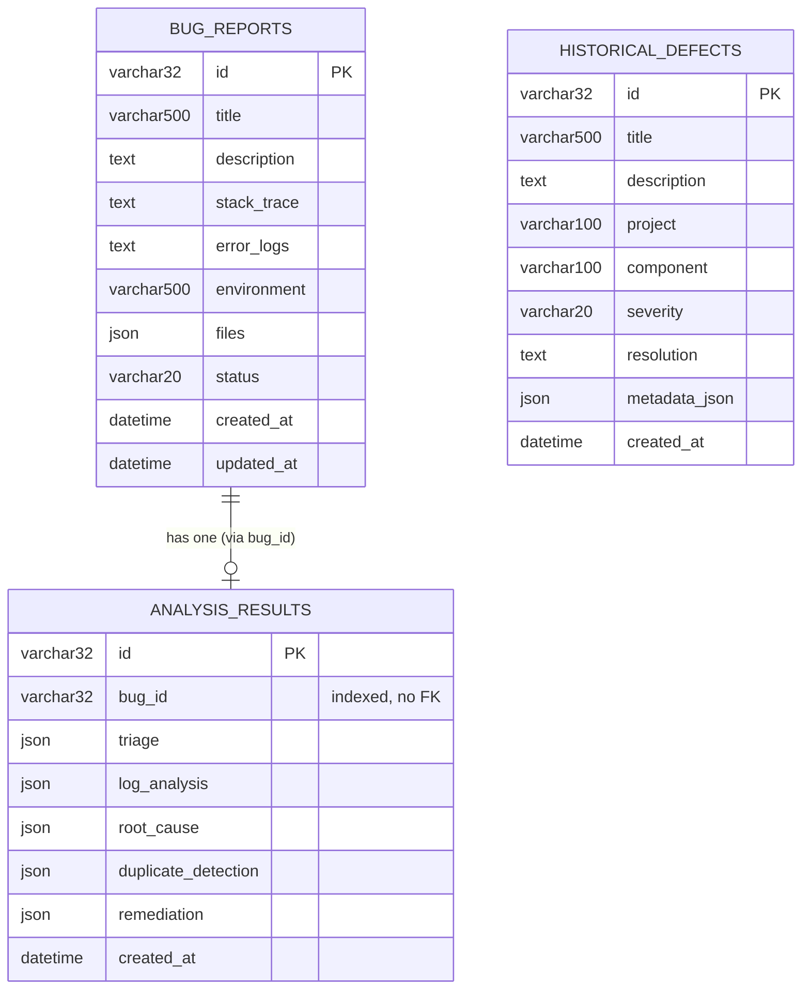
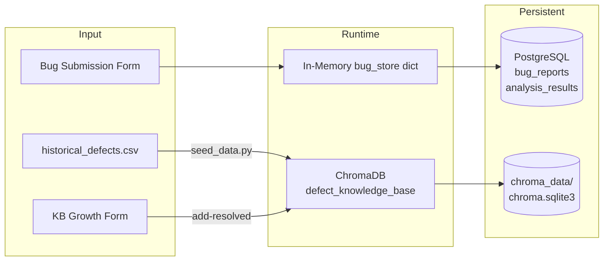

# Database Documentation

## DefectMind AI — Data Storage Reference

---

## Overview

DefectMind AI uses two data stores:

| Store | Technology | Purpose | Status |
|---|---|---|---|
| Relational DB | PostgreSQL 15 + SQLAlchemy 2.0 (async) | Bug reports, analysis results, historical defects | ORM defined; in-memory dict used in demo mode |
| Vector Store | ChromaDB 0.4.18 | 384-dim embeddings for semantic retrieval | Active (mock fallback when not installed) |

In the current deployment, the PostgreSQL ORM models are defined and the tables are created on startup via `Base.metadata.create_all`, but all runtime bug CRUD uses an in-memory Python dictionary (`bug_store`) for simplicity. The vector store (ChromaDB) is the actively-used persistent store.

---

## 1. PostgreSQL Schemas

### 1.1 Connection

**File:** `backend/database/connection.py`

```python
DATABASE_URL = os.getenv(
    "DATABASE_URL",
    # Default is the example value from .env.example — replace with real credentials in production
    "postgresql+asyncpg://postgres:<password>@localhost:5432/defect_analysis"
)
engine = create_async_engine(DATABASE_URL, echo=False)
async_session = async_sessionmaker(engine, class_=AsyncSession, expire_on_commit=False)
```

The engine uses `asyncpg` as the async PostgreSQL driver. `echo=False` suppresses SQL logging in production.

---

### 1.2 `bug_reports` Table

**Model:** `backend/database/models.py` → `BugReport`

| Column | Type | Constraints | Description |
|---|---|---|---|
| `id` | `VARCHAR(32)` | PRIMARY KEY | Auto-generated as `BUG-{12 random hex chars uppercase}` |
| `title` | `VARCHAR(500)` | NOT NULL | Bug title (5–500 chars) |
| `description` | `TEXT` | NOT NULL | Full bug description |
| `stack_trace` | `TEXT` | NULLABLE | Raw stack trace text |
| `error_logs` | `TEXT` | NULLABLE | Error log text |
| `environment` | `VARCHAR(500)` | NULLABLE | Runtime environment description |
| `files` | `JSON` | NULLABLE | List of uploaded file metadata |
| `status` | `VARCHAR(20)` | DEFAULT `'submitted'` | `submitted\|analyzing\|analyzed\|error` |
| `created_at` | `DATETIME` | DEFAULT `utcnow()` | Submission timestamp |
| `updated_at` | `DATETIME` | DEFAULT `utcnow()`, auto-updates | Last modification timestamp |

**DDL equivalent:**
```sql
CREATE TABLE bug_reports (
    id          VARCHAR(32) PRIMARY KEY,
    title       VARCHAR(500) NOT NULL,
    description TEXT NOT NULL,
    stack_trace TEXT,
    error_logs  TEXT,
    environment VARCHAR(500),
    files       JSON,
    status      VARCHAR(20) DEFAULT 'submitted',
    created_at  TIMESTAMP DEFAULT NOW(),
    updated_at  TIMESTAMP DEFAULT NOW()
);
```

---

### 1.3 `analysis_results` Table

**Model:** `backend/database/models.py` → `AnalysisResult`

| Column | Type | Constraints | Description |
|---|---|---|---|
| `id` | `VARCHAR(32)` | PRIMARY KEY | Random 16 hex chars |
| `bug_id` | `VARCHAR(32)` | NOT NULL, INDEXED | Reference to `bug_reports.id` (no FK constraint) |
| `triage` | `JSON` | NULLABLE | Triage agent result |
| `log_analysis` | `JSON` | NULLABLE | Log analysis agent result |
| `root_cause` | `JSON` | NULLABLE | Root cause agent result |
| `duplicate_detection` | `JSON` | NULLABLE | Duplicate detection result |
| `remediation` | `JSON` | NULLABLE | Remediation agent result |
| `created_at` | `DATETIME` | DEFAULT `utcnow()` | Analysis timestamp |

**DDL equivalent:**
```sql
CREATE TABLE analysis_results (
    id                  VARCHAR(32) PRIMARY KEY,
    bug_id              VARCHAR(32) NOT NULL,
    triage              JSON,
    log_analysis        JSON,
    root_cause          JSON,
    duplicate_detection JSON,
    remediation         JSON,
    created_at          TIMESTAMP DEFAULT NOW()
);
CREATE INDEX ix_analysis_results_bug_id ON analysis_results (bug_id);
```

**Note:** There is no foreign key constraint between `analysis_results.bug_id` and `bug_reports.id`. This is intentional for demo flexibility.

---

### 1.4 `historical_defects` Table

**Model:** `backend/database/models.py` → `HistoricalDefect`

| Column | Type | Constraints | Description |
|---|---|---|---|
| `id` | `VARCHAR(32)` | PRIMARY KEY | e.g., `MOZ-1001`, `APC-2003` |
| `title` | `VARCHAR(500)` | NOT NULL | Defect title |
| `description` | `TEXT` | NOT NULL | Full description |
| `project` | `VARCHAR(100)` | NOT NULL | Source project name |
| `component` | `VARCHAR(100)` | NULLABLE | Affected component |
| `severity` | `VARCHAR(20)` | NULLABLE | `critical\|high\|medium\|low` |
| `resolution` | `TEXT` | NULLABLE | How the defect was resolved |
| `metadata_json` | `JSON` | NULLABLE | Additional metadata |
| `created_at` | `DATETIME` | DEFAULT `utcnow()` | Record creation timestamp |

**DDL equivalent:**
```sql
CREATE TABLE historical_defects (
    id            VARCHAR(32) PRIMARY KEY,
    title         VARCHAR(500) NOT NULL,
    description   TEXT NOT NULL,
    project       VARCHAR(100) NOT NULL,
    component     VARCHAR(100),
    severity      VARCHAR(20),
    resolution    TEXT,
    metadata_json JSON,
    created_at    TIMESTAMP DEFAULT NOW()
);
```

**Current usage:** This table is defined but the 12 historical defects are loaded from `data/historical_defects.csv` directly into ChromaDB, not into PostgreSQL. The table is available for future use.

---

### 1.5 Entity Relationship Diagram



---

## 2. In-Memory Store (Demo Mode)

**File:** `backend/routers/bugs.py`

```python
bug_store: dict = {}
```

A module-level Python dictionary used as the runtime data store. Keys are bug IDs; values are dicts containing all bug fields plus the `analysis` key.

**Structure of a stored bug:**
```python
{
  "id": "BUG-A3F12B9C04E8",
  "title": "...",
  "description": "...",
  "stack_trace": "...",
  "error_logs": "...",
  "environment": "...",
  "files": None,
  "status": "analyzed",
  "created_at": "2025-10-14T09:30:00.000000",
  "analysis": {
    "bug_id": "BUG-A3F12B9C04E8",
    "timestamp": "...",
    "milestone": "M3",
    "triage": { ... },
    "log_analysis": { ... },
    "root_cause": { ... },
    "duplicate_detection": { ... },
    "remediation": { ... },
    "agents": { ... },
    "total_duration": 0.187
  }
}
```

**Limitation:** Contents are lost when the server process restarts.

---

## 3. ChromaDB Vector Store

### 3.1 Overview

| Property | Value |
|---|---|
| Engine | ChromaDB 0.4.18 |
| Client type | `PersistentClient` |
| Persistence path | `./chroma_data` (configurable via `CHROMA_PERSIST_DIR`) |
| Persistent file | `chroma_data/chroma.sqlite3` |
| Collection name | `defect_knowledge_base` |
| Distance metric | Cosine similarity (`hnsw:space = cosine`) |
| Embedding dimensions | 384 |
| Embedding model | `sentence-transformers/all-MiniLM-L6-v2` |

### 3.2 Collection Schema

Each document in `defect_knowledge_base` has:

| Field | Type | Description |
|---|---|---|
| `id` | `string` | Unique document identifier (e.g., `MOZ-1001`, `KB-xxxx`) |
| `document` | `string` | Full text that was embedded |
| `embedding` | `float[384]` | Cosine-similarity embedding vector |
| `metadata` | `dict` | See metadata fields below |

**Metadata fields:**

| Key | Type | Description | Required |
|---|---|---|---|
| `project` | `string` | Source project name | For seeded data |
| `component` | `string` | Affected component | Recommended |
| `severity` | `string` | `critical\|high\|medium\|low` | Recommended |
| `resolution` | `string` | Resolution text | For seeded/KB-growth data |
| `source` | `string` | Where the record came from | For seeded data |
| `added_via` | `string` | `knowledge_base_growth_m4` | For M4.2-added entries |
| `resolution_confirmed` | `boolean` | Whether fix is validated | For M4.2-added entries |
| `timestamp` | `string` | ISO 8601 when added | For M4.2-added entries |
| `root_cause` | `string` | Identified root cause (truncated to 200 chars) | For M4.2-added entries |
| `original_bug_id` | `string` | The originating bug ID | If provided |
| `exception_type` | `string` | Exception class name | If provided |
| `category` | `string` | Bug category | If provided |
| `priority` | `string` | `P0\|P1\|P2\|P3` | If provided |
| `added_at` | `string` | *(alias for timestamp)* | For M4.2 entries |

### 3.3 Seeded Documents

The `seed_data.py` script loads 12 defects from `historical_defects.csv`, chunking each into up to 3 segments:

| Chunk ID | Content | Metadata section |
|---|---|---|
| `{id}-title` | Defect title | `section: "title"` |
| `{id}-description` | Full description | `section: "description"` |
| `{id}-resolution` | Resolution text | `section: "resolution"` |

**Total seeded documents:** Up to 36 chunks from 12 defects (some defects may have no resolution).

**Seeded defects:**

| ID | Project | Component | Severity |
|---|---|---|---|
| MOZ-1001 | Mozilla Firefox | Networking | critical |
| MOZ-1002 | Mozilla Firefox | Layout Engine | high |
| MOZ-1003 | Mozilla Firefox | Graphics | high |
| MOZ-1004 | Mozilla Firefox | CSS Engine | medium |
| APC-2001 | Apache HTTP Server | Core | critical |
| APC-2002 | Apache Tomcat | Thread Pool | critical |
| APC-2003 | Apache HTTP Server | HTTP Parser | critical |
| APC-2004 | Apache Tomcat | Connection Pool | high |
| ECL-3001 | Eclipse JDT | Compiler | medium |
| ECL-3002 | Eclipse Platform | UI Framework | high |
| ECL-3003 | Eclipse JDT | Content Assist | medium |
| ECL-3004 | Eclipse Platform | Plugin Framework | critical |

### 3.4 ChromaDB Operations

**`ChromaService.search(query_embedding, top_k, where)`**
```python
results = self.collection.query(
    query_embeddings=[query_embedding],  # List of 1 embedding
    n_results=top_k,
    where=where if where else None       # Metadata filter (optional)
)
# Returns: {ids, documents, metadatas, distances}
# Score = 1 - distance (cosine distance → cosine similarity)
```

**`ChromaService.add_documents(ids, documents, embeddings, metadatas)`**
```python
self.collection.add(
    ids=ids,
    documents=documents,
    embeddings=embeddings,
    metadatas=metadatas
)
```

**`ChromaService.get_all_documents(limit=500)`** — Used by analytics for cluster analysis and document enumeration.

**`ChromaService.get_document_by_id(doc_id)`** — Used by KB verification endpoint.

**`ChromaService.document_exists(doc_id)`** — Used to prevent ID collisions on add.

### 3.5 Mock Fallback

When ChromaDB is not installed (`ImportError`), the service uses:

1. **Search:** Returns 5 hardcoded results (MOZ-1001, APC-2003, ECL-3003, MOZ-1002, APC-2002) with fixed scores (0.89, 0.82, 0.75, 0.71, 0.68).

2. **Add/Get/Exists:** Uses a class-level `_mock_store: dict = {}` dictionary. Documents added via `add_documents` are stored here and retrievable via `get_document_by_id` and `document_exists`. This dict is cleared between tests via the `clear_bug_store` fixture.

---

## 4. Data Flow Summary



**Current state:** PostgreSQL write path exists in models but is not used at runtime — `MEM → PG` path is dotted/future. ChromaDB path is fully active.

---

## 5. Environment Variables

> **Security note:** The values shown here match `.env.example`. They are example/default values only. Always replace `POSTGRES_PASSWORD` and the password in `DATABASE_URL` with a strong secret before any deployment.

| Variable | Example default | Description |
|---|---|---|
| `DATABASE_URL` | `postgresql+asyncpg://postgres:<password>@localhost:5432/defect_analysis` | Full PostgreSQL connection string — set password via `POSTGRES_PASSWORD` |
| `POSTGRES_USER` | `postgres` | Username for Docker Compose |
| `POSTGRES_PASSWORD` | *(set in `.env` — never commit)* | Password for Docker Compose |
| `POSTGRES_DB` | `defect_analysis` | Database name |
| `POSTGRES_PORT` | `5432` | PostgreSQL port |
| `CHROMA_PERSIST_DIR` | `./chroma_data` | ChromaDB persistence directory |
| `EMBEDDING_MODEL` | `sentence-transformers/all-MiniLM-L6-v2` | Embedding model identifier |
| `EMBEDDING_DIMENSIONS` | `384` | Vector dimensionality |
