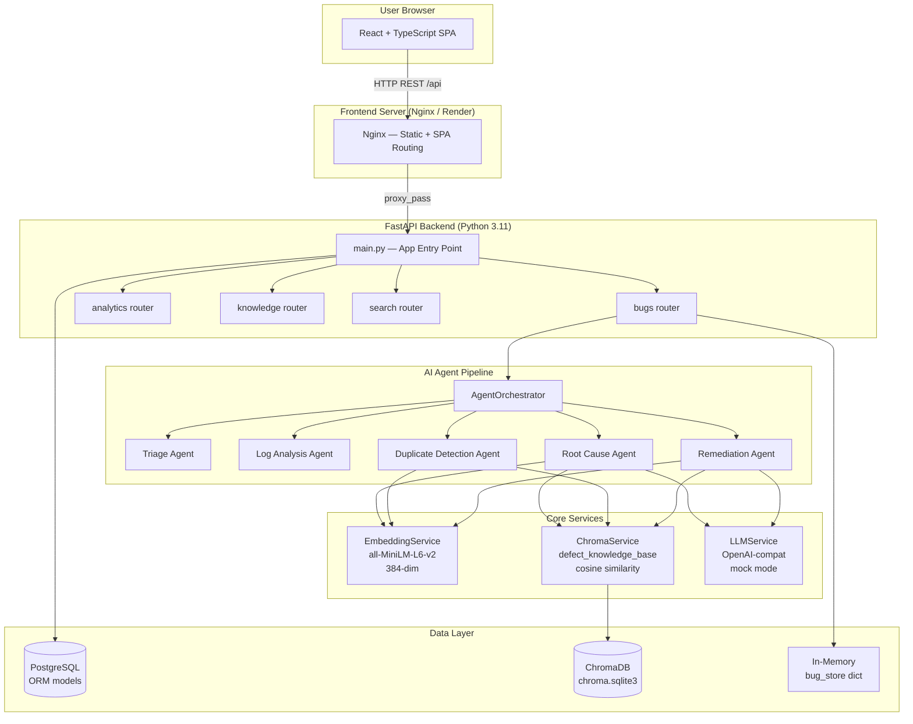
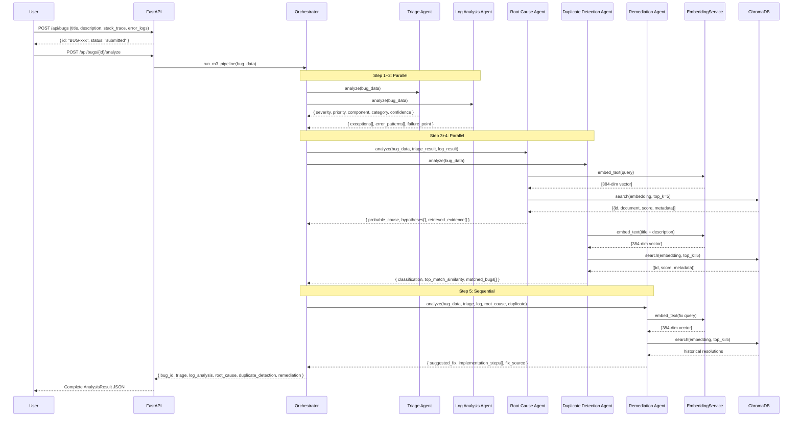
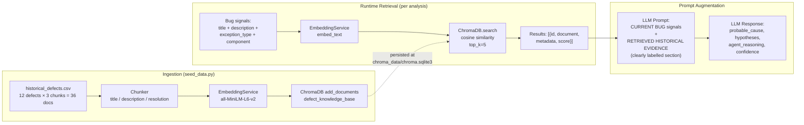
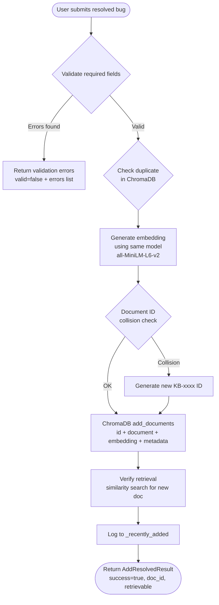
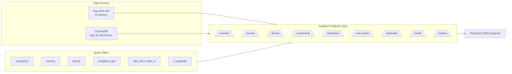
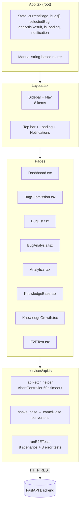
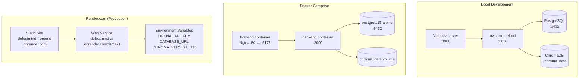
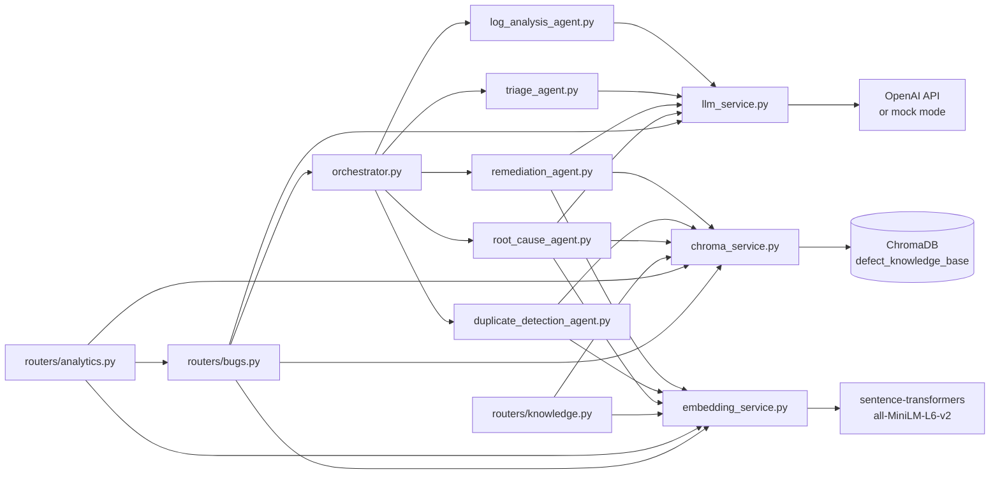
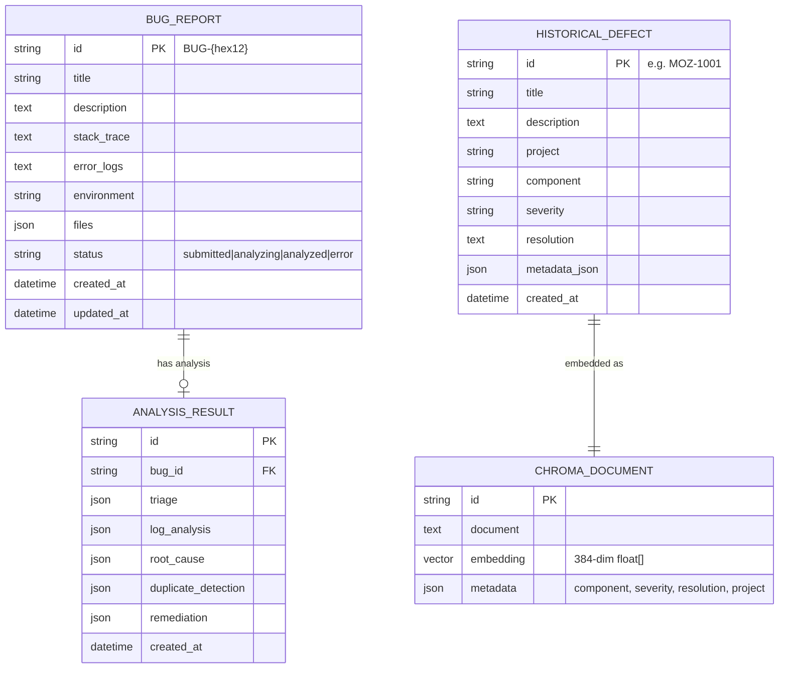

# System Architecture

## DefectMind AI — Architecture Documentation

**Version:** 4.0.0-M4
**Backend:** https://defectmind-ai.onrender.com/
**Frontend:** https://defectmind-frontend.onrender.com/

---

## 1. High-Level Architecture

---

## 2. Agent Pipeline Data Flow

---

## 3. RAG Pipeline

---

## 4. Knowledge Base Growth Workflow (M4.2)

---

## 5. Analytics Architecture (M4.1)

---

## 6. Frontend Architecture

---

## 7. Deployment Architecture

---

## 8. Service Dependency Graph

---

## 9. Data Model Overview

---

## 10. Parallel Execution Model

```mermaid
gantt
    title Agent Pipeline Execution (asyncio.gather)
    dateFormat  X
    axisFormat  %Ls

    section Wave 1 (parallel)
    Triage Agent        : 0, 80
    Log Analysis Agent  : 0, 80

    section Wave 2 (parallel)
    Root Cause Agent       : 80, 250
    Duplicate Detection    : 80, 200

    section Wave 3 (sequential)
    Remediation Agent   : 250, 380

    section Total
    Complete Pipeline   : 0, 380
```

*Times are approximate and depend on whether mock or real LLM is used.*

---

## 11. Technology Stack Summary

| Layer | Technology | Version | Role |
|---|---|---|---|
| Frontend | React | 18.2 | UI framework |
| Frontend | TypeScript | 5.7 | Type safety |
| Frontend | Vite | 6.3 | Build tool + dev server |
| Frontend | Tailwind CSS | 4.1 | Utility-first styling |
| Frontend | Recharts | 2.10 | Analytics charts |
| Frontend | Lucide React | 0.294 | Icon library |
| Backend | Python | 3.11 | Runtime |
| Backend | FastAPI | 0.104 | HTTP framework |
| Backend | Pydantic | 2.5 | Data validation |
| Backend | Uvicorn | 0.24 | ASGI server |
| Database | PostgreSQL | 15 | Relational DB (ORM defined, in-memory used in demo) |
| Database | SQLAlchemy | 2.0 | Async ORM |
| Vector DB | ChromaDB | 0.4.18 | Vector store + cosine similarity |
| ML | sentence-transformers | 2.2.2 | `all-MiniLM-L6-v2` 384-dim embeddings |
| ML | numpy | 1.26.2 | Vector math |
| LLM | httpx | 0.25.2 | OpenAI API client |
| Container | Docker | - | Container runtime |
| Container | Docker Compose | v3.8 | Multi-service orchestration |
| Deployment | Render.com | - | Cloud platform |
| Web Server | Nginx | alpine | Static file serving + API proxy |
